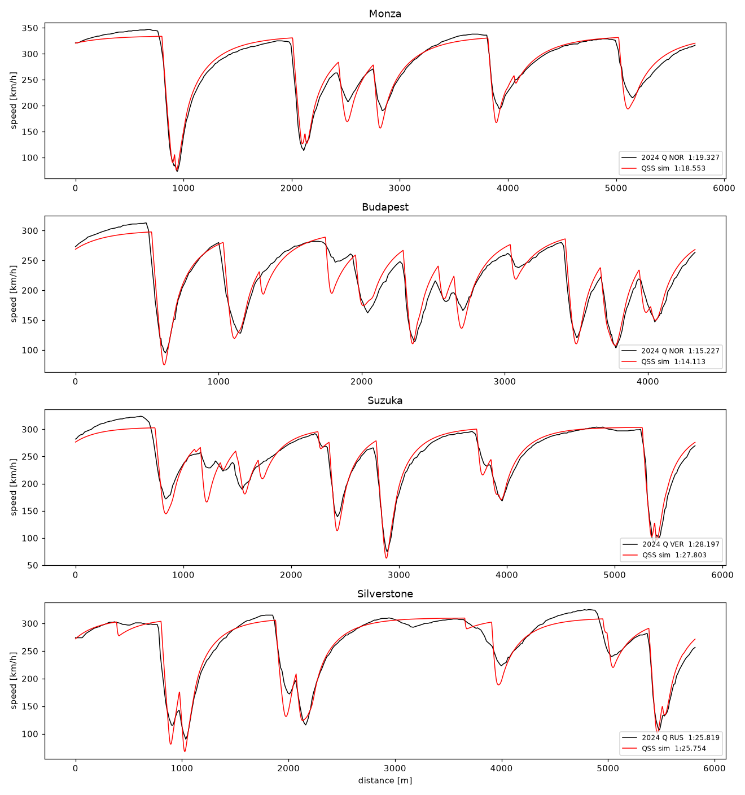
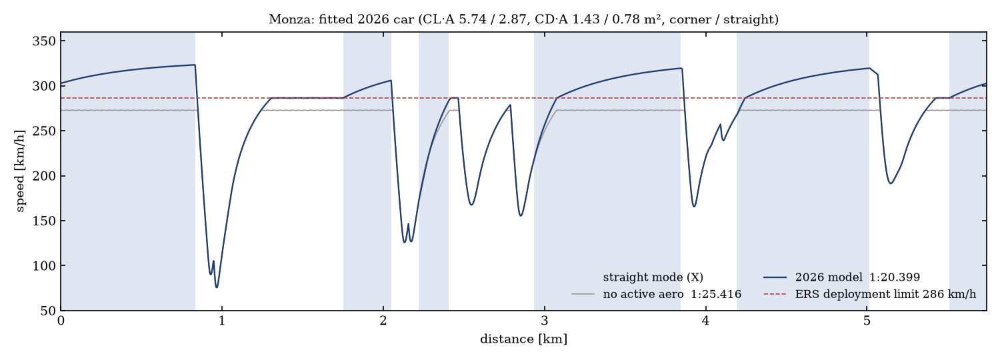
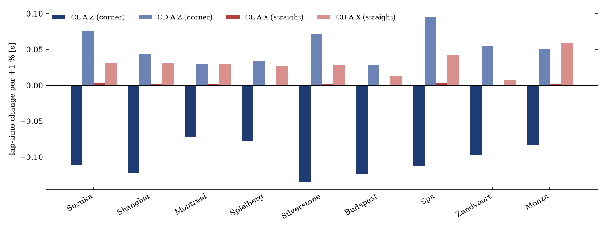
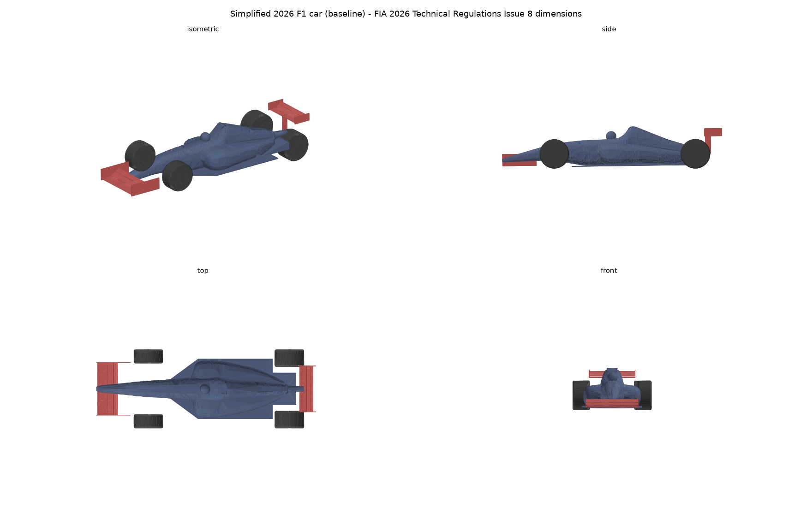
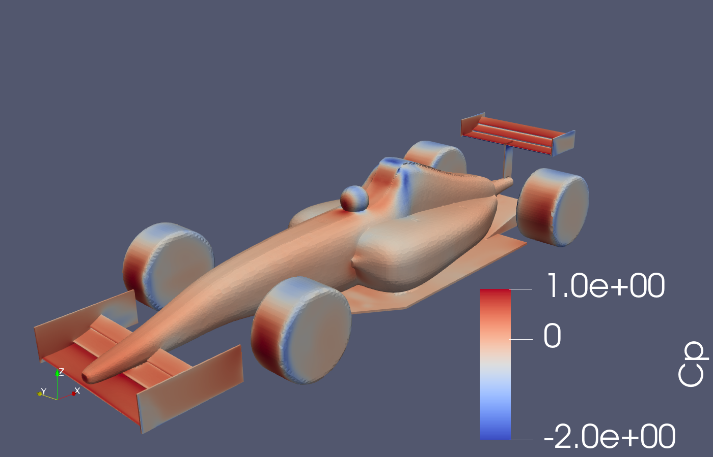
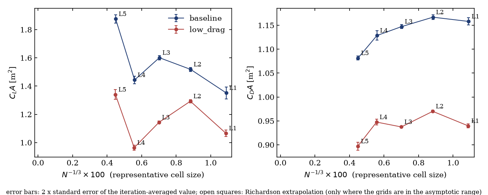

# F1 Aero Simulation

F1 셋업 파라미터(윙 각도, 라이드 하이트, 사이드포드 형상 등)를 바꿨을 때
**공력 성능이 어떻게 바뀌고, 그 결과 실제 서킷에서 랩타임이 얼마나 달라지는지**를
예측하는 프로젝트입니다.

```
셋업 파라미터 ─▶ 파라메트릭 CAD ─▶ OpenFOAM (대칭 반쪽 모델, RANS)
                                        │
                                        ▼
            랩타임 ◀─ QSS 랩 시뮬레이터 ◀─ 공력 서로게이트 (CL·A, CD·A)
                                        │
                                        ▼
                           웹 데모 (GitHub Pages, 브라우저 내 추론)
```

## 진행 상황

| 단계 | 내용 | 상태 |
|---|---|---|
| 1 | QSS 랩타임 시뮬레이터 + 실제 F1 텔레메트리 검증 | ✅ 2024 검증, 2026 규정 버전 추가 |
| 2 | 파라메트릭 단순화 F1 형상 (CadQuery, 2026 기술규정 기준) | 🔧 1차 형상 완료 |
| 3 | OpenFOAM 자동 해석 파이프라인 (multi-fidelity) | 🔧 파이프라인 동작, 격자 독립성 확인 중 |
| 4 | 공력 서로게이트 학습 → 랩 시뮬 연결 | ⏳ |
| 5 | 웹 데모 + LLM 에이전트 | ⏳ |

## 1단계: 랩타임 시뮬레이터

**모델**: 질점(point-mass) 준정상(QSS) 모델
- 레이싱 라인: 트랙 중심선과 폭(TUMFTM racetrack-database)에서 최소 곡률 경로를 OSQP로 구합니다.
- 코너 한계 속도: 공력 다운포스와 타이어 하중 민감도를 반영한 횡방향 그립으로 계산합니다.
- 가속과 감속: 출력 한계, 구동축 트랙션, 마찰 타원, 공기저항, 구름저항을 고려합니다.
- 한 랩 계산 시간은 약 0.03초입니다.

**검증**: [FastF1](https://github.com/theOehrlein/Fast-F1)로 2024 예선 최고 랩의 속도 트레이스와 비교했습니다.

서킷마다 팀이 다른 공력 세팅을 쓰기 때문에, CL·A와 CD·A를 서킷별로 실제 속도 트레이스에 맞춰 역산했습니다.

| 서킷 | CL·A [m²] | CD·A [m²] | L/D | 실제 (예선 1위) | 시뮬 | 오차 |
|---|---|---|---|---|---|---|
| Monza | 6.14 | **1.36** (최저 드래그) | 4.52 | 1:19.327 (NOR) | 1:18.553 | −0.77 s |
| Budapest | **8.00** (최대 다운포스) | 1.89 | 4.24 | 1:15.227 (NOR) | 1:14.113 | −1.11 s |
| Suzuka | 6.50 | 1.84 | 3.53 | 1:28.197 (VER) | 1:27.803 | −0.39 s |
| Silverstone | 7.06 | 1.72 | 4.10 | 1:25.819 (RUS) | 1:25.754 | −0.06 s |

저드래그 서킷(Monza)과 최대 다운포스 서킷(Hungaroring)의 차이가 역산 결과에 그대로 나타납니다.
값은 질점 모델과 타이어 가정의 오차까지 흡수한 **유효값**입니다.



**알려진 한계**
- ERS 에너지 한계(직선 끝 clipping), 기어 변속, DRS를 아직 반영하지 않았습니다.
- 질점 모델이라 공력 밸런스(앞뒤 다운포스 배분)의 영향은 보지 못합니다. 이후 2축(bicycle) 모델로 확장할 예정입니다.
- 트랙 데이터에 연석이 포함되지 않고 측량 노이즈가 있어, 곡률 평활화(σ = 8 m)를 적용했습니다.

## 1단계 확장: 2026 규정 랩 모델과 CFD 정확도 목표

`lapsim/rules2026.py`는 같은 질점 QSS 모델에 2026 규정을 얹은 것이다(FIA 2026 Technical Regulations Issue 8).

| 항목 | 반영 내용 | 근거 |
|---|---|---|
| 중량 | 724 kg + 타이어(약 44 kg) + 예선 연료 6 kg = 774 kg | Art. 4.2 (타이어·연료는 가정) |
| ICE | 크랭크 400 kW (연료 에너지 유량 3000 MJ/h 한계) | 5.4.3 (출력값은 가정) |
| ERS-K | 최대 350 kW. 290 km/h부터 줄어 345 km/h에서 0 | 5.4.7, 5.4.8 |
| 에너지 | 회수 ≤ 8.5 MJ/랩, 충전 상태 변동 폭 4 MJ → 예선 랩 배치(전개) ≤ 4 MJ + 회수량. 속도 기준값 아래에서만 전개(클리핑) | 5.4.9, 5.4.10 |
| 가변 공력 | 직선(반경 800 m 초과, 150 m 이상)에서 가속 중이면 X 모드(저항 저감), 그 밖과 모든 제동은 Z 모드(코너) | 3.10.9, 3.11.6 (구간 기준은 가정) |

**2026 실측과 맞추기**: 2026 텔레메트리는 공개 서버가 인증을 요구해서 받지 못했다. 대신 공개 API(Jolpica)의 **2026 예선 최고 랩타임**에 맞췄다.
- 맞춘 값: 모든 서킷 공통의 공력 세팅 하나(코너 모드 CL·A, CD·A)
- 직선 모드 값: 코너 모드에 대한 비율 0.50, 0.55로 가정
- 결과: CL·A **5.74 / 2.87**, CD·A **1.43 / 0.78** m² (코너 / 직선). 9개 서킷 랩타임 RMS 오차 **1.32 s**
- 직선 모드 항력은 2024 평균보다 54% 낮다. FIA가 발표한 2026 목표(항력 −55%)와 같은 수준이다.
- Melbourne과 Catalunya는 트랙 데이터가 2022, 2023년 레이아웃 변경 이전이라 제외했다.



**공력 민감도와 CFD 정확도 목표** ([docs/results/aero_sensitivity_2026.md](docs/results/aero_sensitivity_2026.md))



- 랩타임에 가장 큰 영향은 **코너 모드 CL·A**다(1 %에 0.07~0.13 s). 다음은 코너 모드 CD·A와 직선 모드 CD·A다. 직선 모드 CL·A는 거의 영향이 없다.
- 모델 자체 오차(약 1.3 s)를 생각하면 현실적인 HF 목표는 랩 ±0.5 s 수준이다. 그러면 CL·A ±2 %, CD·A ±2.5 %, 직선 모드 CD·A ±4 %가 된다.
  grid1의 CFD 흔들림(CL·A 26~33 %)은 이 목표의 10배 이상이다.

## 2단계: 2026 규정 기반 단순화 형상

FIA 2026 F1 Technical Regulations (Issue 8, 2024-06-24)의 기본 치수와 Appendix 1
Reference Volume을 따라 CadQuery로 만든 파라메트릭 형상입니다.

- **규정에서 가져온 값**: 휠베이스 3400 mm, 폭 1900 mm, 18인치 림, 앞날개·뒷날개·바닥·사이드포드·엔진커버 기준 볼륨, 날개 요소 간격(앞 5–15 mm, 뒤 10–15 mm)
- **단순화한 부분**: 차체는 초타원 단면 로프트, 날개는 NACA 6412 역캠버 단면 3장입니다. 사이드포드는 막혀 있고, 헤일로·미러·서스펜션·브레이크덕트·플로어 보드·플랭크는 넣지 않았습니다.
- **가정한 값**: 타이어 외경·폭(공급사 데이터), 라이드 하이트(앞 30 mm, 뒤 80 mm), 날개 받음각
- **좌표계**: FIA 규정과 같습니다(X 후방 +, Y 운전자 오른쪽 +, Z 위 +). 원점은 앞차축이고 노면은 Z = 0입니다.
- **출력**: `cad/out/<이름>/`에 부품별 STL(m 단위, snappyHexMesh용)과 STEP(mm), 파라미터 JSON을 저장합니다. `--half`를 주면 Y ≥ 0 반쪽 모델(대칭면 해석용)을 만듭니다.
- **빌드 후 확인 항목**: 각 부품이 단일 유효 솔리드인지, STL이 닫힌 매니폴드인지, 주요 규정 치수를 지키는지 확인합니다.
- **기준 볼륨 검사**(2026-10-21, `cad/regvol.py`): 규정 본문에 적힌 기준 볼륨(앞날개 §17–22, 바닥 §4–7, 미러 §10, 뒷날개 §25–27, 지지대 §31)을 그대로 만들어, 부품이 그 밖으로 나간 부피와 깊이를 잽니다.
  **G1은 모든 검사를 만족하도록 고쳤고(2026-10-21), 앞으로 만드는 형상도 이 검사를 통과해야 빌드됩니다.**
  G0는 격자 연구 기준이라 동결했고, 앞날개·뒷날개·바닥이 기준 볼륨을 벗어난 규정 미준수 형상입니다(정보로만 출력).
  단면 비교: `docs/figures/regvol_sections_g1.png`, `regvol_sections_g0.png`(`scripts/plot_regvol.py`). FIA CAD 파일로만 정의된 볼륨(차체 생존셀, 디퓨저 RV-DIFF)은 검사하지 못합니다.



## 3단계: OpenFOAM 해석 파이프라인

반쪽 모델 정상 RANS 해석입니다(OpenFOAM v2512, `simpleFoam`, k-ω SST, 벽함수).
- **경계 조건**: Y = 0 대칭면, 차량과 같은 속도(50 m/s)로 움직이는 노면, 노면 속도에 맞춰 회전하는 타이어
- **격자**: `snappyHexMesh`, 프리즘 3층. 단계 L1~L5는 배경 셀 크기만 1.33배씩 줄이고 나머지 설정은 같습니다(GCI용 계열).
- **결과**: 부품별(앞날개·차체·뒷날개·바퀴) 힘을 매 반복 기록합니다. `cfd_report.py`가 전체 차량 기준 CL·A·CD·A(`--aref`를 주면 CL·CD)로 바꿔 줍니다. y+도 함께 출력합니다.
- **실행 위치**: 가벼운 해석은 로컬(Windows에서는 WSL로 자동 실행), 무거운 해석은 클러스터(Slurm)에서 `grid_study.py`로 돌립니다.
- **보기**: 각 케이스 폴더의 `pv_view.py`(`paraview --script=pv_view.py`)가 표면 Cp와 중심선 속도 화면을 바로 띄웁니다.

| 격자 | 배경 셀 | 날개 표면 셀 | 셀 수 | 메싱 | 3000회 해석 | 메모리 최대 |
|---|---|---|---|---|---|---|
| L1 | 400 mm | 6.3 mm | 0.77M | 1.0분 (8코어) | 19.5분 (8코어) | 2.6 GB |
| L2 | 300 mm | 4.7 mm | 1.45M | 1.3분 (16코어) | 18.7분 (16코어) | 5.0 GB |
| L3 | 225 mm | 3.5 mm | 2.88M | 2.4분 (32코어) | 19.8분 (32코어) | 10.3 GB |
| L4 | 169 mm | 2.6 mm | 5.71M | 5.1분 (32코어) | 40.6분 (32코어) | 15.5 GB |
| L5 | 127 mm | 2.0 mm | 11.0M | 7.5분 (64코어) | 44.9분 (64코어) | 30.2 GB |

계산 비용은 클러스터에서 4.0~5.2 코어·초 / (100만 셀 × 1회 반복)이었습니다.
메모리는 대략 100만 셀당 2.7 GB입니다. 그래서 RAM 32 GB인 데스크톱(WSL 약 26 GB 할당)에서는 L4까지가 한계입니다.
(초기 로컬 측정: i5-4570 4코어, 층 없는 0.56M 셀 격자, 1.79 s/반복, 12.8 코어·초)



### 격자 독립성 1차 (`grid1`, 2026-10-16)

두 설계를 L1~L5에서 각각 3000회 돌리고, 마지막 1000회 평균을 비교했습니다. 반복 평균의 통계 오차는 CL·A ±0.02 m², CD·A ±0.005 m² 이내입니다.
- **baseline**: 기본 플랩 각도
- **low_drag**: 앞 플랩 −10°, 뒷 플랩 −25°. 2026 가변 공력의 직선 모드를 흉내 낸 설정입니다.



- **CL·A는 수렴하지 않았습니다.** 격자를 키울수록 오르내리고, L4→L5에서도 약 30% 바뀝니다(baseline 1.44 → 1.88 m²). 그래서 L3~L5에 대해 Richardson 외삽과 GCI는 성립하지 않습니다(점근 영역 아님). 변화의 대부분은 **차체(바닥 아래)**에서 나옵니다(차체 CL·A −0.14 → +0.16).
- **CD·A는 L1~L4에서 ±2% 안**이지만, L5에서 4% 더 내려갑니다. 단조 수렴이 아니어서 이것도 GCI는 계산하지 않았습니다.
- **두 설계의 차이:** ΔCD·A는 L4·L5에서 −0.181, −0.184로 안정적입니다. ΔCL·A는 L3 −0.46, L4 −0.48, L5 −0.54로 아직 변하고 있습니다.
- **판단:** high fidelity 격자와 low fidelity 격자는 아직 정할 수 없습니다. 원인 후보는 두 가지입니다.
  1. 바닥 아래 틈(30~80 mm)이 배경 격자에만 의존해 해상됩니다.
  2. 프리즘 층이 표면 셀에 비례해 얇아지면서 y+(차체 평균 220 → 90)가 단계마다 바뀌어, 벽함수 조건이 함께 변합니다.

  다음 연구(`grid2`)에서는 바닥 아래 리파인 박스와 절대 두께로 고정한 첫 층을 넣고 다시 확인합니다.

전체 표·부품별 값·층 품질은 [docs/results/grid1/grid_study.md](docs/results/grid1/grid_study.md)에 있습니다.

### 격자 연구 2차 설정 (`grid2`, 2026-10-20)

grid1에서 찾은 두 원인을 고친 격자 계열이다(`make_cfd_case.py --scheme grid2`). `--scheme grid1`(기본값)은 이전 케이스를 그대로 다시 만든다.

| 항목 | grid1 | grid2 |
|---|---|---|
| 바닥 아래 틈, 디퓨저 | 표면 레벨에만 의존 | 리파인 박스 2개, 레벨 5 (L1 12.5 mm → L5 4 mm) |
| 프리즘 층 | 표면 셀에 비례 (y+가 단계마다 바뀜) | 첫 층 0.8 mm 고정, 성장비 1.25, 3층 (y+ 약 50~80) |
| 바퀴 표면 레벨 | 4 | 5 (레벨 4에서는 층이 1~1.4층만 생김) |
| 층 처리 | featureAngle 60 | featureAngle 130, 층 추가 시 비직교 75까지 허용 |

L1 시험(이 PC, 50회): 셀 93.6만, 층 차체 2.1층·날개 2.5~2.7층·바퀴 2.5층, 평균 y+ 날개 47~49·차체 77·바퀴 80, 메모리 2.2 GB.
HF 판정 기준은 [공력 민감도](docs/results/aero_sensitivity_2026.md)에서 정한 CL·A ±2 %, CD·A ±2.5 %다.


## 사용법

```bash
python -m venv .venv
.venv\Scripts\activate          # Windows
pip install -r requirements.txt

python scripts/run_lap.py Monza --calibrated            # 한 랩 시뮬 + 그림
python scripts/run_lap.py Suzuka --cla 7.0 --cda 1.6    # 공력값 직접 지정
python scripts/validate.py Monza Suzuka --calibrated    # 실제 랩과 비교
python scripts/calibrate_aero.py Monza Budapest         # 서킷별 공력 역산

python scripts/fit_2026.py                              # 2026 예선 랩타임에 공통 공력 세팅 맞춤 → data/aero_2026.json
python scripts/run_lap_2026.py Monza                    # 2026 랩 한 바퀴 (가변 공력·ERS 구간 표시)
python scripts/aero_sensitivity_2026.py                 # 공력 민감도 → CFD 정확도 목표

python scripts/build_car.py                             # 2026 단순화 형상 (전체)
python scripts/build_car.py --half                      # 대칭면 해석용 반쪽 모델
python scripts/build_car.py --fw-flap-delta -10 --rw-flap-delta -25 --name low_drag
python scripts/build_car.py --half --details            # 헤일로·서스펜션·프론트 휠 웨이크 보드·미러 포함
python scripts/build_car.py --half --fia                # FIA 2026 컨셉카 스타일(G1) + 상세 부품
python scripts/render_car.py baseline_half fia2026_half # 3D 렌더 비교

python scripts/make_cfd_case.py --level L1 --np 4          # cfd/runs/baseline_half_L1
python scripts/run_cfd.py cfd/runs/baseline_half_L1          # 메싱 + 해석 (Windows는 WSL에서)
python scripts/cfd_report.py cfd/runs/baseline_half_L1 --aref 1.474   # 시간·메모리·CL/CD 정리

# 격자 연구 (클러스터, Slurm). 접속 정보는 환경변수로만 줌: F1CFD_HPC=user@host:port, F1CFD_NODES="노드1 노드2"
python scripts/grid_study.py prepare grid1 --configs baseline=cad/out/baseline_half low_drag=cad/out/low_drag_half
python scripts/grid_study.py push grid1        # 전송 + 제출 (prepare --add 로 단계 추가 후에도 같은 명령)
python scripts/grid_study.py status grid1
python scripts/grid_study.py fetch grid1       # 로그와 힘 데이터만 회수
python scripts/grid_study.py analyze grid1     # GCI, 외삽, 설계 차이(경향) 비교

# 클러스터 없이 이 PC에서 순서대로 실행 (grid2 예)
python scripts/grid_study.py prepare grid2 --configs baseline=cad/out/baseline_half --levels L1 L2 L3 L4 --np L1=6 L2=6 L3=6 L4=6 --iter 2000 --scheme grid2
python scripts/grid_study.py run-local grid2 --levels L1 L2 L3   # 끝난 케이스는 건너뜀, 끊겨도 같은 명령으로 재개
```

## 구조

```
lapsim/          랩타임 시뮬레이터 (track, vehicle, qss, reference)
scripts/         실행·검증·보정 스크립트
data/tracks/     서킷 중심선 데이터 (TUMFTM, LGPL-3.0)
cad/             파라메트릭 2026 F1 형상 (car2026.py), 출력은 cad/out/ (git 제외)
cfd/templates/   OpenFOAM 케이스 템플릿 (반쪽 차량), 실행 케이스는 cfd/runs/ (git 제외)
surrogate/       공력 서로게이트 모델 (예정)
web/             웹 데모 (예정)
docs/figures/    결과 그림
docs/results/    해석 결과 요약 (격자 연구 등)
docs/worklog.md  날짜별 작업 기록과 다음 할 일
```

## 데이터 출처
- 서킷 형상: [TUMFTM/racetrack-database](https://github.com/TUMFTM/racetrack-database) (LGPL-3.0)
- 실제 랩 텔레메트리: [FastF1](https://github.com/theOehrlein/Fast-F1)
- 2024/2026 예선 랩타임: [Jolpica-F1 API](https://github.com/jolpica/jolpica-f1) (`data/quali_best_2024_2026.json`)
